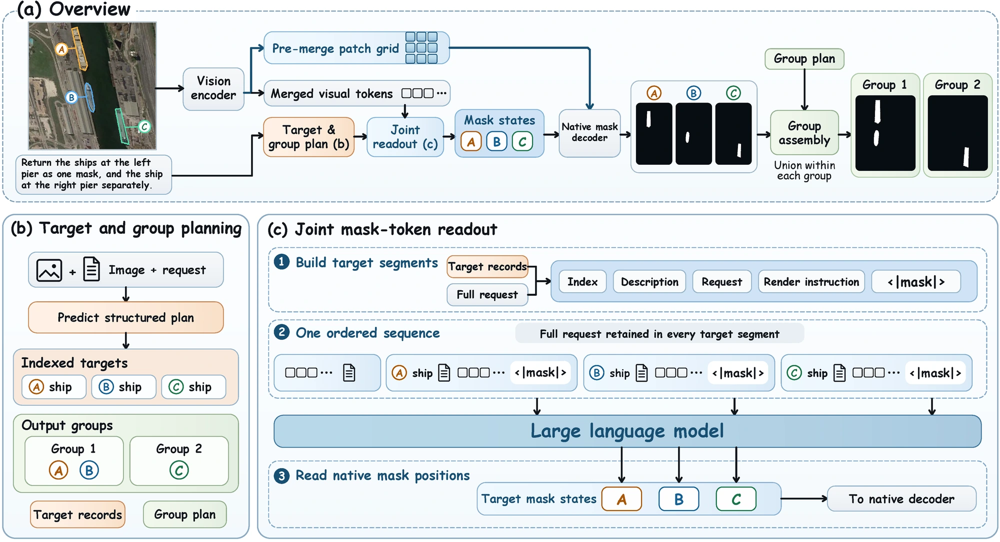
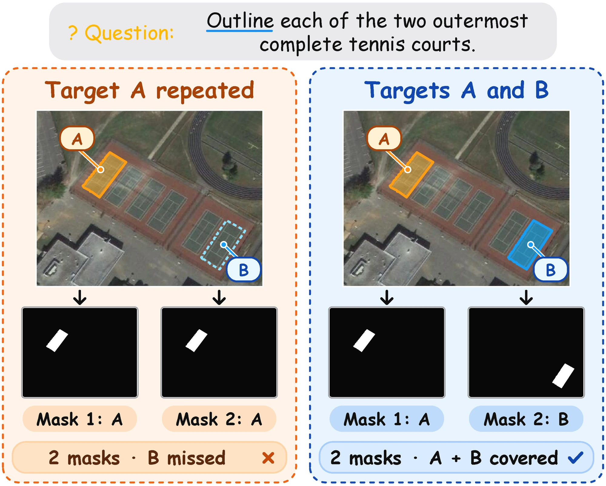
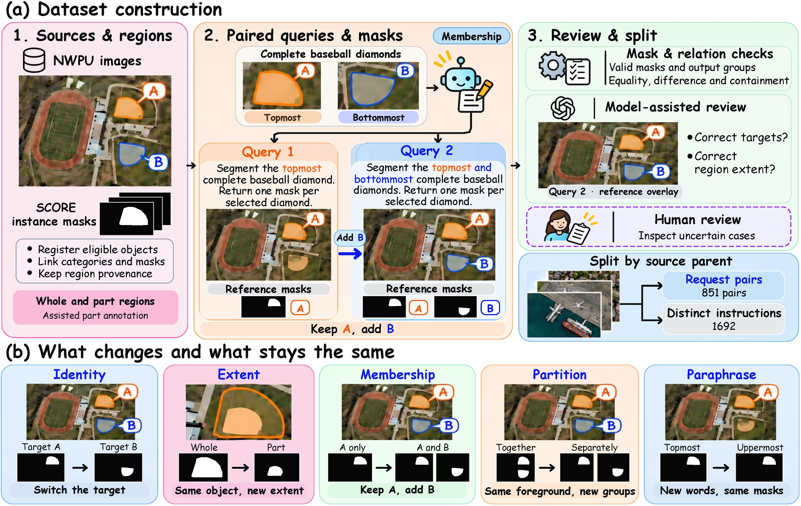
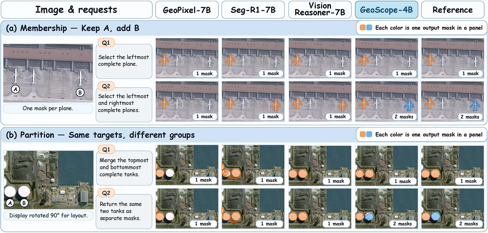
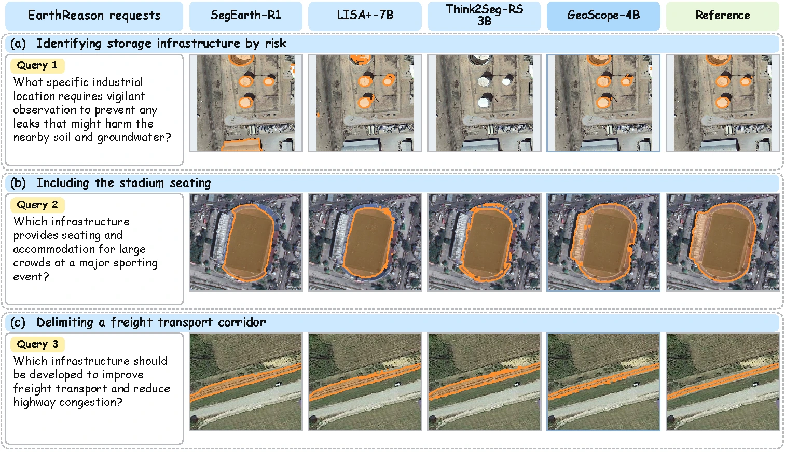
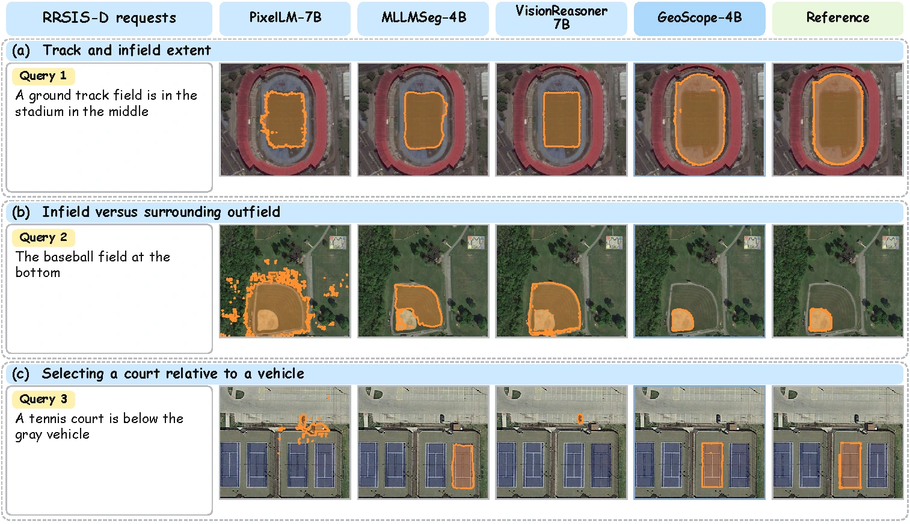

<div align="center">

<h1>GeoScope: What to Mask and What to Merge in Remote Sensing Reasoning Segmentation</h1>

[](#citation)
[](#experimental-configuration)
[-0D9488?style=flat-square)](#geoscope-bench)
[](#release-roadmap)
[](LICENSE)

[Release Roadmap](#release-roadmap) · [Overview](#overview) · [GeoScope-Bench](#geoscope-bench) · [Results](#results) · [Getting Started](#getting-started) · [Evaluation](#evaluation) · [Configuration](#experimental-configuration) · [Citation](#citation)

</div>

---

## News & Updates

- **`2026-11`**: Released the **GeoScope** project page, experimental configuration ([`configs/geoscope_4b.yaml`](configs/geoscope_4b.yaml)), standalone **GeoScope-Bench** evaluation & schema toolkit ([`eval/`](eval/)), and sample annotation schemas ([`examples/`](examples/)).

## Release Roadmap

- [x] Project overview, configs (`configs/`), and sample schemas (`examples/`)
- [x] **GeoScope-Bench** evaluation & schema toolkit (`eval/`)
- [ ] Full **GeoScope-Bench** dataset *(upon paper decision)*
- [ ] **GeoScope** training and inference code *(upon paper decision)*
- [ ] Pretrained **GeoScope-4B** checkpoints

## Overview

<table>
  <tr>
    <td><em>In dense aerial scenes with visually similar objects, how can a reasoning segmenter explicitly decouple <strong>what to localize</strong> from <strong>how to group masks</strong>—and prevent multiple queries from collapsing onto the same salient instance?</em></td>
  </tr>
</table>

<p align="center">
  <a href="assets/method.webp">
    
  </a>
</p>

**GeoScope** is a scope-aware remote sensing reasoning segmentation framework built on `Qwen3.5-4B`. It separates atomic instance localization from topological output mask grouping:

- **Structured Target and Group Planning.** Given an aerial image and natural-language instruction, the planner produces an ordered list of indexed atomic target descriptions together with explicit output group assignments, allowing the same localized instances to be merged or separated without re-grounding.
- **Joint Mask-Token Readout.** Instead of decoding identical descriptors independently (which produces collinear queries that duplicate the same dominant instance), GeoScope concatenates all planned target segments with designated `<|mask|>` tokens in a single causal forward pass. Causal self-attention conditions later mask-token states on earlier target context for implicit feature-space de-duplication while processing the shared visual prefix only once.
- **Mask Decoding and Group Assembly.** Each target state scores a shared pre-merge spatial patch grid via scaled inner products, and each requested output mask is assembled as the binary union of its assigned atomic target masks.

<details>
<summary><strong>Motivation: Why returning the requested mask count can still miss a target</strong></summary>

<p align="center">
  <a href="assets/motivation.webp">
    
  </a>
</p>

When asked for a separate mask for each outermost complete tennis court, returning two masks does not guarantee covering both courts: independent readout can localize court A twice and leave court B uncovered.

</details>

## GeoScope-Bench

<p align="center">
  <a href="assets/dataset.webp">
    
  </a>
</p>

**GeoScope-Bench** evaluates scope-aware instruction execution using **851 same-image instruction pairs** (**1,692 distinct instructions** across **404 aerial images** curated from NWPU-VHR-10 and SCORE) spanning five controlled transformations:

| Transformation | What Changes | Development Pairs | Test Pairs | Total Pairs |
| :---: | :--- | :---: | :---: | :---: |
| **Identity** | Parallel spatial qualifier switches the target instance | 167 | 33 | 200 |
| **Extent** | Whole-to-part revision narrows the spatial extent | 40 | 19 | 59 |
| **Membership** | Adds an eligible instance as a separate output mask | 166 | 32 | 198 |
| **Partition** | Keeps the foreground fixed; switches merged vs. separate groups | 163 | 34 | 197 |
| **Paraphrase** | Equivalent rewording preserves targets, extents, and groups | 165 | 32 | 197 |
| **Total Pairs** | Strictly disjoint splits by source image | **701** | **150** | **851** |
| **Distinct Instructions** | Shared endpoints counted once per split | **1,392** | **300** | **1,692** |
| **Images** | Source-level zero-overlap split | **345** | **59** | **404** |

<details>
<summary><strong>Inspect sample GeoScope-Bench pair &amp; plan schemas</strong></summary>

Sample paired records covering all five transformations are provided in [`examples/geoscope_bench_samples.jsonl`](examples/geoscope_bench_samples.jsonl), and structured plan examples are in [`examples/plan_output_examples.json`](examples/plan_output_examples.json).

```json
{
  "pair_id": "geoscope-sample-partition-0004",
  "transformation": "partition",
  "image": "images/NWPU-VHR-10/sample_storage_tanks.jpg",
  "image_size": [600, 800],
  "request_a": {
    "instruction": "Merge the two topmost complete storage tanks into a single output mask.",
    "targets": [
      {"target_id": 1, "category": "storage tank", "description": "storage tank"},
      {"target_id": 2, "category": "storage tank", "description": "storage tank"}
    ],
    "groups": [{"group_id": 1, "target_ids": [1, 2]}]
  },
  "request_b": {
    "instruction": "Return the two topmost complete storage tanks as two separate output masks.",
    "targets": [
      {"target_id": 1, "category": "storage tank", "description": "storage tank"},
      {"target_id": 2, "category": "storage tank", "description": "storage tank"}
    ],
    "groups": [{"group_id": 1, "target_ids": [1]}, {"group_id": 2, "target_ids": [2]}]
  }
}
```

</details>

## Results

<p align="center">
  <a href="assets/qualitative.webp">
    
  </a>
</p>

<details>
<summary><strong>GeoScope-Bench Test (%)</strong></summary>

The five transformation columns report **Group gIoU**. **Bold** and <u>underline</u> denote the best and second-best scores per column.

| Method | Identity | Extent | Membership | Partition | Paraphrase | Group gIoU / cIoU | Pair Success |
| :--- | :---: | :---: | :---: | :---: | :---: | :---: | :---: |
| LISA+-7B | 30.48 | 46.60 | 23.57 | 29.56 | 36.09 | 32.03 / 33.44 | 10.00 |
| GSVA-7B | 16.73 | 26.99 | 12.42 | 11.01 | 15.99 | 15.66 / 15.34 | 2.00 |
| PSALM | 13.97 | 32.86 | 7.81 | 8.91 | 14.74 | 14.07 / 7.87 | 3.33 |
| PixelLM-7B | 31.95 | 20.78 | 31.25 | 20.88 | 29.13 | 27.27 / 24.81 | 11.33 |
| GeoPixel-7B | 16.44 | 13.03 | 14.08 | 16.42 | 15.02 | 15.20 / 21.72 | 1.33 |
| SegEarth-R1 | 13.15 | 40.99 | 11.05 | 16.00 | 29.85 | 20.44 / 22.37 | 4.67 |
| Seg-R1-7B | 47.61 | 33.95 | 30.09 | 28.73 | 51.02 | 38.59 / 29.77 | 16.67 |
| MLLMSeg-4B | 41.51 | 51.57 | 26.50 | 25.35 | 53.40 | 38.46 / <u>50.05</u> | <u>18.67</u> |
| Think2Seg-RS-3B | 46.23 | 42.36 | <u>36.77</u> | 34.31 | 47.05 | 41.19 / 38.92 | 14.67 |
| VisionReasoner-7B | <u>48.00</u> | <u>53.83</u> | 31.61 | <u>35.64</u> | <u>57.64</u> | <u>44.50</u> / 44.49 | 16.00 |
| RemoteReasoner-7B | 37.52 | 47.88 | 26.23 | 30.60 | 52.16 | 37.98 / 42.27 | 17.33 |
| **GeoScope-4B (Ours)** | **66.90** | **58.35** | **58.67** | **60.94** | **62.88** | **61.85** / **60.46** | **49.33** |

</details>

### EarthReason

<p align="center">
  <a href="assets/earthreason.webp">
    
  </a>
</p>

### Zero-Shot Referring Segmentation (RRSIS-D)

<p align="center">
  <a href="assets/rrsisd.webp">
    
  </a>
</p>

## Getting Started

### Repository Structure

```text
GeoScope/
├── README.md                              # Project overview, benchmark details, and results
├── LICENSE                                # Apache License 2.0
├── requirements.txt                       # Lightweight dependencies for evaluation tools
├── assets/                                # Paper figures (motivation, method, dataset, qualitative, EarthReason, RRSIS-D)
├── configs/
│   └── geoscope_4b.yaml                   # Public experimental configuration for GeoScope-4B
├── eval/
│   ├── __init__.py
│   ├── metrics.py                         # Union/Group IoU, Hungarian matching, Request Pass, Pair Success
│   ├── score_predictions.py               # CLI scorer for GeoScope-Bench predictions + self-test
│   └── validate_schema.py                 # Manifest schema & 6-rule mask integrity auditor
└── examples/
    ├── geoscope_bench_samples.jsonl       # Sample paired records for all five transformations
    └── plan_output_examples.json          # Structured Target & Group Planning examples
```

### Installation

```bash
git clone https://github.com/YeeCharm/GeoScope.git
cd GeoScope
pip install -r requirements.txt
```

### Quick Check

Validate the sample benchmark manifest and run the built-in synthetic metric self-test:

```bash
python -m eval.validate_schema --manifest examples/geoscope_bench_samples.jsonl
python -m eval.score_predictions --self-test
```

## Evaluation

### Evaluation Protocol

- **Foreground vs. Group Scores**: **Union gIoU/cIoU** evaluates merged foreground coverage; **Group gIoU/cIoU** performs one-to-one maximum-sum-IoU Hungarian matching between predicted and reference output masks, accounting for unmatched groups in both the gIoU denominator $\max(n,m,1)$ and the pooled cIoU union.
- **Request Pass $A(I,q)$**: Requires exact output group count $K$, every matched group $\text{IoU} \ge 0.5$, and target-identity margin compliance against competing references.
- **Pair Success**: Requires both paired requests to pass $A(\cdot)$ and satisfy the transformation-specific relation $C_i$ (e.g., $\text{IoU} \ge 0.7$ for preserved targets or partition unions, and $\ge 90\%$ part containment with strict area ordering for whole-to-part extent revisions).

### Scoring Predictions

Each line of the predictions JSONL file maps a `request_id` to a list of predicted binary output group masks (PNG paths relative to `--pred-root`, or uncompressed column-major RLE dictionaries):

```json
{"request_id": "geoscope-sample-partition-0004-b", "masks": ["preds/0004_b_g1.png", "preds/0004_b_g2.png"]}
```

Run schema + mask integrity auditing and score predictions:

```bash
# 1. Verify benchmark manifest and all six programmatic mask constraints (Appendix A.2)
python -m eval.validate_schema \
  --manifest data/geoscope_bench/test.jsonl \
  --mask-root data/geoscope_bench \
  --check-masks

# 2. Score model predictions and export JSON summary
python -m eval.score_predictions \
  --manifest data/geoscope_bench/test.jsonl \
  --predictions outputs/geoscope_4b/test_predictions.jsonl \
  --mask-root data/geoscope_bench \
  --pred-root outputs/geoscope_4b \
  --output outputs/geoscope_4b/test_summary.json
```

## Experimental Configuration

| Model | Backbone | Config | LoRA (r / &alpha;) | Peak LR (LoRA / Decoder) | Effective Batch | Pixel Budget |
| :---: | :---: | :---: | :---: | :---: | :---: | :---: |
| GeoScope-4B | `Qwen/Qwen3.5-4B` | [`geoscope_4b.yaml`](configs/geoscope_4b.yaml) | 64 / 128 | `2e-4` / `2e-5` | 64 | 262,144 – 1,048,576 |

## Acknowledgements

We thank the authors and communities behind the following open-source datasets and base models:

- **NWPU-VHR-10** & **SCORE** — source imagery and instance annotations used in constructing GeoScope-Bench
- **EarthReason ([SegEarth-R1](https://github.com/earth-insights/SegEarth-R1))** & **LaSeRS ([SegEarth-R2](https://github.com/earth-insights/SegEarth-R2))** — remote sensing reasoning segmentation benchmarks
- **RRSIS-D**, **RISBench**, & **RefSegRS** — remote sensing referring segmentation benchmarks
- **[Qwen3.5](https://huggingface.co/Qwen)** — open-weight multimodal backbone

## Citation

If you find **GeoScope** or **GeoScope-Bench** useful in your research, please consider citing:

```bibtex
@article{luo2026geoscope,
  title={GeoScope: What to Mask and What to Merge in Remote Sensing Reasoning Segmentation},
  author={Luo, Yichang and Liu, Shixiong and Wei, Kan and Zhao, Yan and Yang, Boxiang and Wang, Lei},
  year={2026}
}
```

## License

This project is released under the [Apache License 2.0](LICENSE).
